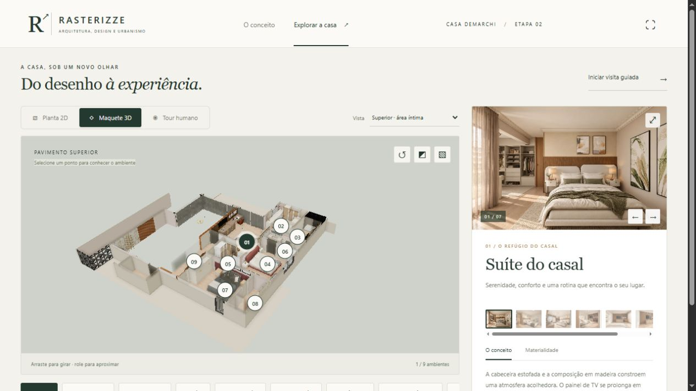
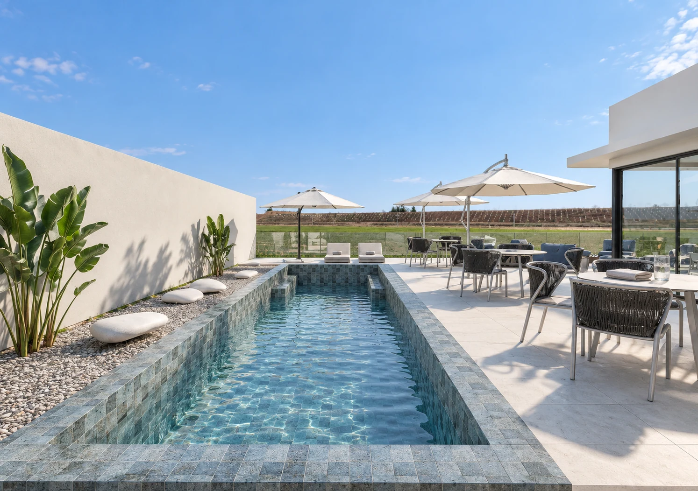
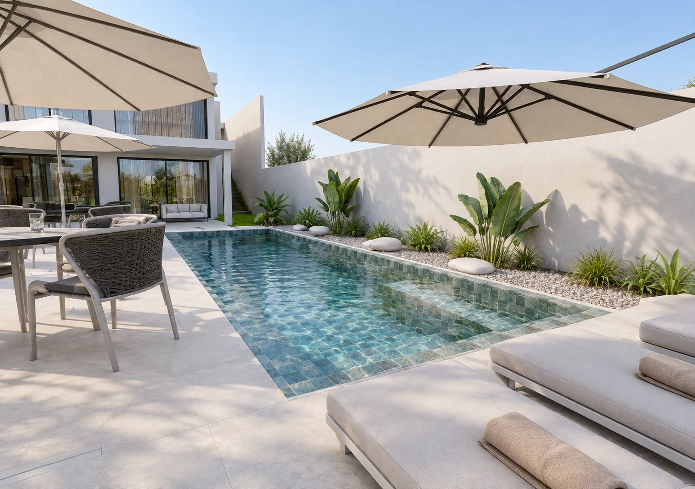
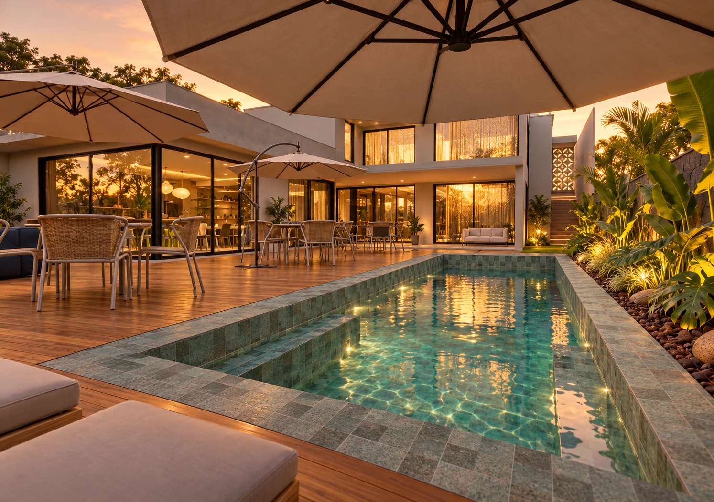

# Casa Demarchi

### Uma casa para acolher. Conectar. Pertencer.

**Rasterizze · Arquitetura, Design e Urbanismo**

Uma apresentação de arquitetura para explorar: do conceito à planta, da maquete ao olhar de quem vive a casa. Os interiores da **Etapa 02** conduzem a narrativa, acompanhados pela implantação e pelos espaços de convívio e lazer.

## [↗ Abrir a experiência online](https://jhonylira.github.io/Esperiencia_web_Casa_demarchi/)

Sem instalação para visitar pelo navegador. Para apresentar em tela cheia, use **F11** ou o botão no cabeçalho.



### Área externa · três vistas, a mesma materialidade

<p>
  
  
  
</p>

[Explorar a piscina e o deck ↗](https://jhonylira.github.io/Esperiencia_web_Casa_demarchi/#explorar/lazer)

## Escolha como conhecer a casa

| Experiência | O que você encontra |
| --- | --- |
| **O conceito** | Atmosfera, materiais e soluções dos ambientes, ilustrados pelos renders. |
| **Planta 2D** | Plantas humanizadas com pontos clicáveis e acesso direto aos ambientes. |
| **Maquete 3D** | Uma leitura espacial do térreo, do superior e da implantação completa. |
| **Tour humano** | Uma visita em escala humana com Lívia, Juli, Ricardo ou Luna. |
| **Galerias** | Vistas ampliáveis, descrição do conceito e materialidade de cada ambiente. |

### Um percurso sugerido

1. Comece em **O conceito** para conhecer a intenção do projeto.
2. Entre em **Explorar a casa** e escolha **Superior**, **Térreo** ou **Implantação**.
3. Clique em um ponto ou no nome de um ambiente para ver seus renders e detalhes.
4. Escolha **Tour humano** para visitar os ambientes por outro olhar.

## Controles da visita

| Ação | Controle |
| --- | --- |
| Girar a maquete | Arrastar sobre a cena |
| Aproximar ou afastar | Rolar o mouse |
| Olhar no tour | Clicar na cena e arrastar |
| Caminhar | **W A S D**, setas ou botões da tela |
| Acelerar | **Shift** |
| Pular com a Luna | **Espaço** ou botão **Pular** |
| Ampliar um render | Clicar na imagem |
| Percorrer imagens ampliadas | Setas do teclado |
| Fechar a imagem ampliada | **Esc** |

A circulação do tour é livre, sem colisões. O seletor **Vista** troca o pavimento; **Ver meu personagem** alterna a câmera de acompanhamento. A implantação usa a câmera de órbita para mostrar a volumetria da casa.

## Apresentar localmente

**Entrega portátil para Windows:** dê dois cliques em **ABRIR APRESENTACAO.vbs**. Mantenha a pasta completa da entrega.

**Clone deste repositório:** com Node.js instalado, execute:

```sh
node server.mjs
```

Abra [http://127.0.0.1:4173/](http://127.0.0.1:4173/). Não há instalação de dependências nem etapa de build. O runtime Windows da entrega portátil fica fora do Git.

## Sobre os arquivos

- `dist/`: aplicação HTML, CSS, JavaScript e recursos visuais.
- `dist/assets/`: renders, miniaturas, plantas e modelos otimizados.
- `server.mjs`: serviço local para a apresentação.
- `LEIA-ME.md`: orientações completas de uso.
- `RELATORIO_FINAL.md`: fontes, verificações e critérios de representação.

As bibliotecas são locais. Os modelos carregam sob demanda, e o modelo do tour é distribuído em partes para publicação no GitHub. O workflow de GitHub Pages publica a aplicação após atualizações na branch `main`.

As imagens e maquetes são representações de apresentação. Especificações e soluções executivas devem ser consultadas na documentação técnica do projeto.
